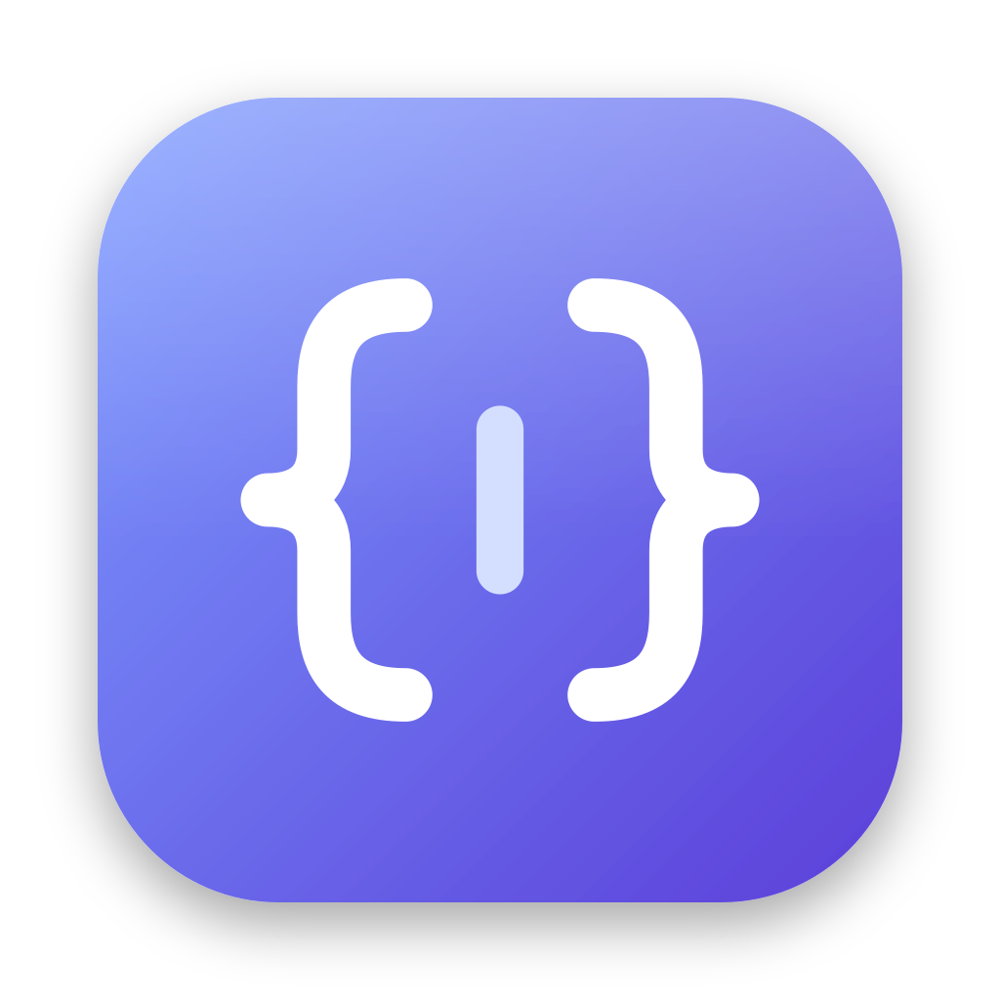
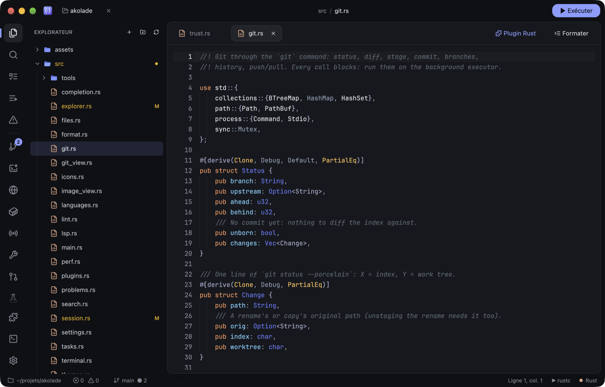
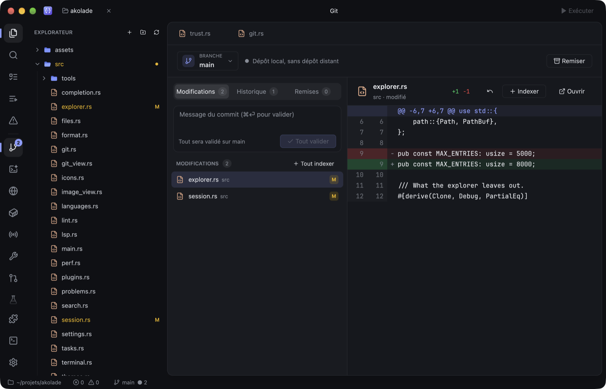
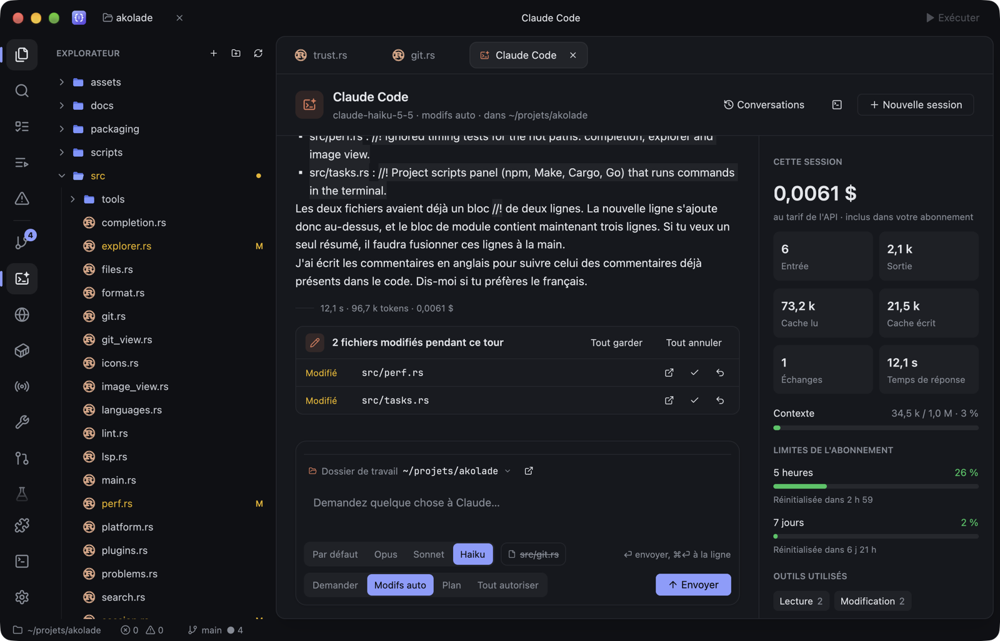
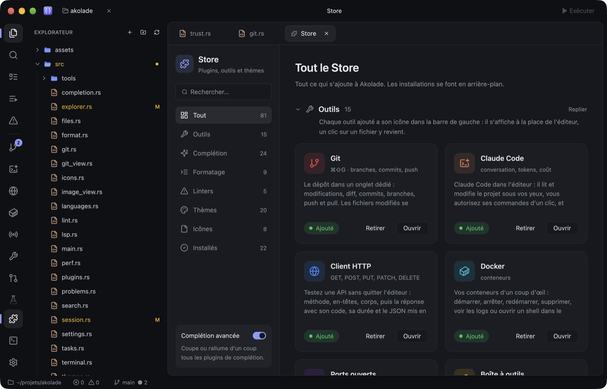
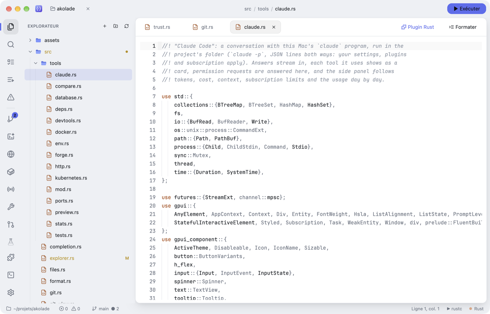

<p align="center">
  
</p>

<h1 align="center">Akolade</h1>

<p align="center">
  Un éditeur de code natif écrit en Rust, avec Claude Code intégré.<br>
  35 langages colorés, un terminal, Git et une quinzaine d'outils. Pour macOS, Windows et Linux.
</p>

<p align="center">
  <a href="https://emmanuellion.github.io/akolade/">Page de présentation</a>
  &nbsp;&nbsp;
  <a href="#installer-akolade">Télécharger</a>
  &nbsp;&nbsp;
  <a href="#raccourcis-clavier">Raccourcis</a>
</p>



Akolade dessine son interface sur la carte graphique avec [gpui](https://www.gpui.rs), le moteur de l'éditeur Zed. Tout tourne dans un seul processus : la fenêtre s'affiche en 0,05 s, et l'app reste à 0,3 % de CPU quand vous ne tapez pas. L'interface est en français.

## Sommaire

- [Ce que fait Akolade](#ce-que-fait-akolade)
- [Claude Code dans l'éditeur](#claude-code-dans-léditeur)
- [Les outils](#les-outils)
- [Le Store](#le-store)
- [Sécurité : le mode restreint](#sécurité--le-mode-restreint)
- [Performances](#performances)
- [Installer Akolade](#installer-akolade)
- [Raccourcis clavier](#raccourcis-clavier)
- [Configurer un projet](#configurer-un-projet)
- [Développement](#développement)
- [Licence et crédits](#licence-et-crédits)

## Ce que fait Akolade

**L'éditeur**

- Coloration syntaxique par tree-sitter pour 35 langages, chacun avec sa propre couleur (Python en bleu, Rust en orange, JavaScript en jaune).
- Complétion intégrée qui marche sans rien installer : elle apprend les mots du fichier et les classe selon le contexte (début d'instruction, expression, accès à un membre).
- Complétion avancée, documentation au survol, aller à la définition (F12), références (⇧F12), renommage (F2) et corrections rapides (⌘.) avec les serveurs de langage installés depuis le Store.
- Formatage d'un raccourci (⌥⇧F), erreurs soulignées pendant la frappe.
- Deux fichiers côte à côte (⌘\\), aperçu Markdown à côté du code, visionneuse d'images.
- Bouton Exécuter (⌘R) pour lancer le fichier ouvert : 22 langages ont déjà leur commande.

**Autour du code**

- Explorateur avec l'état Git de chaque fichier.
- Recherche et remplacement dans tout le projet (⌘⇧F).
- Panneaux Problèmes, TODO (les `TODO`, `FIXME`, `HACK` et `XXX` du projet) et Scripts (ceux de `package.json`, du `Makefile`, de Cargo et de Go).
- Terminal intégré (⌃\`).
- Onglets rouverts au retour sur un projet, ⇧⌘T pour rouvrir un onglet fermé.

**Git**

Un onglet complet : modifications avec leur diff, indexation, commit, historique, branches, remises (stash), push et pull. Les lignes modifiées sont marquées dans la marge de l'éditeur.



## Claude Code dans l'éditeur

Si [Claude Code](https://claude.com/code) est installé sur votre ordinateur, Akolade en fait une conversation dans un onglet. Il utilise votre propre `claude`, avec vos réglages, vos plugins et votre abonnement : Akolade ne voit passer aucune clé.

- **Les réponses arrivent au fil de l'eau**, en Markdown.
- **Chaque outil utilisé par Claude a sa carte** : la commande lancée, le fichier lu, le diff d'une modification. Un clic ouvre le fichier dans l'éditeur, et les onglets ouverts se rechargent dès que Claude modifie un fichier.
- **Chaque tour liste les fichiers modifiés** (commandes comprises) : un clic montre le diff, et chaque fichier se garde ou s'annule. Au survol d'un message, « Revenir avant ce message » remet les fichiers du projet comme ils étaient. Il faut un dépôt Git : les instantanés sont des objets Git, sans toucher à vos branches, à votre index ni à vos remises.
- **Les autorisations se donnent dans la carte** : Autoriser, Refuser ou Toujours autoriser. Ce dernier dit ce qu'il retient (« Ne plus demander : Commande « git status * », dans ce projet ») et l'écrit dans le `.claude/settings.local.json` du projet, comme Claude Code. Quand Claude pose une question à choix multiples, ses options s'affichent en boutons.
- **⏎ envoie, ⇧⏎ ou ⌘⏎ va à la ligne.** Pendant que Claude travaille, un nouveau message se met en file et part dès qu'il a fini ; Arrêter interrompt le tour.
- **Images et longs textes** : une image collée part avec le message, un long texte collé devient une pièce jointe au lieu de remplir la zone de saisie.
- **Les commandes `/`** : celles de Claude Code, de vos skills et de vos plugins, proposées dès qu'on tape `/`.
- **Quatre modes** : Demander, Modifs auto, Plan et Tout autoriser (avec confirmation). On choisit aussi le modèle, l'effort et un budget maximum par session.
- **Le suivi de la session** : coût estimé au tarif de l'API, tokens (entrée, sortie, cache), remplissage du contexte, limites de l'abonnement sur 5 heures et 7 jours, outils utilisés, fichiers modifiés.
- **L'historique** : coût et tokens par jour, avec un graphique des 14 derniers jours.
- **Les conversations passées** du projet, avec leur titre, leur date et leur coût. Un clic en reprend une.
- **Le dossier de travail** est affiché en permanence, et on peut en choisir un autre que celui du projet.



## Les outils

Chaque outil ajouté depuis le Store a son icône dans la barre de gauche.

| Outil | Ce qu'il fait |
|---|---|
| Git | Le dépôt : modifications, diff, commits, branches, remises, push et pull |
| Claude Code | La conversation, les autorisations, le coût et les limites |
| Client HTTP | GET, POST, PUT, PATCH, DELETE avec en-têtes et corps ; la réponse avec son code, sa durée et le JSON mis en forme. Les requêtes s'enregistrent dans le projet |
| Docker | Démarrer, arrêter, redémarrer ou supprimer un conteneur, lire ses logs, ouvrir un shell |
| Kubernetes | Pods, déploiements et services par namespace ; logs, shell, mise à l'échelle, redirection de port |
| Ports ouverts | Les programmes qui écoutent sur un port, à ouvrir dans le navigateur ou à arrêter |
| Tests | cargo, go, pytest, jest et vitest : ce qui passe, ce qui casse, le message de chaque échec |
| Pull requests | Les PR GitHub et GitLab du dépôt, leurs commentaires, leurs tests et leurs relectures |
| Base de données | Les bases SQLite du projet : tables, lignes et requêtes, en lecture seule par défaut |
| Variables d'environnement | Les fichiers `.env` en tableau, secrets masqués, variables manquantes par rapport à `.env.example` |
| Aperçu en direct | Un serveur local pour vos pages HTML, rechargées à chaque enregistrement |
| Comparateur | Deux textes ou deux fichiers, ligne par ligne ou côte à côte |
| Dépendances | Les paquets npm, Cargo, Python et Go, leurs mises à jour et l'audit de sécurité. Rien n'est jamais installé |
| Statistiques | Lignes de code par langage, plus gros fichiers, fichiers les plus modifiés, contributeurs |
| Boîte à outils | JSON, Base64, URL, JWT, SHA-256, horodatages, UUID |

## Le Store



Le Store regroupe 81 éléments, installés en arrière-plan :

| Catégorie | Nombre | Exemples |
|---|---|---|
| Outils | 15 | ceux du tableau ci-dessus |
| Complétion | 24 | TypeScript, Python (basedpyright), C et C++ (clangd), Vue, Astro, Bash… |
| Formatage | 9 | Prettier, ruff, rustfmt, gofmt, clang-format, shfmt, taplo… |
| Linters | 5 | ESLint, ruff, ShellCheck, hadolint, Clippy |
| Thèmes | 20 | Minuit, Abysse, Forêt, Aube, Papier… et l'import d'un thème VS Code |
| Icônes | 8 | huit façons de dessiner les fichiers |



## Sécurité : le mode restreint

Ouvrir un projet ne doit jamais exécuter son code. Or beaucoup d'outils le font sans prévenir : ESLint exécute `eslint.config.js`, Clippy compile les `build.rs`, Git lance les commandes de `.git/config`, Claude Code lance les hooks de `.claude/settings.json`.

Un dossier ouvert pour la première fois est donc en **mode restreint**, signalé dans la barre d'état. Dans ce mode :

- ESLint, Clippy et les serveurs de langage qui exécutent la configuration du projet (Ruby, GraphQL) sont en pause.
- Les programmes fournis par le projet (`node_modules/.bin/…`) ne sont jamais lancés à la place des vôtres.
- Git se met en pause si le dépôt configure une commande (hooks, filtres, `core.fsmonitor`, `core.sshCommand`…). Un dépôt cloné normalement fonctionne sans rien demander.
- Claude Code, les tests, les scripts, Prettier et l'audit des dépendances demandent votre accord avant de démarrer.

Un clic sur « Mode restreint » lève ces limites pour ce dossier. Les dossiers de confiance se gèrent dans Paramètres › Sécurité.

Akolade n'a ni compte ni télémétrie. Il ne se connecte à rien de lui-même : seuls les programmes que vous lancez le font (Claude Code, npm pour installer un plugin, `gh` pour les pull requests, curl dans le client HTTP).

## Performances

Mesuré sur un MacBook Pro M5 Pro (macOS 27.0.1), avec la version release, le code source d'Akolade ouvert comme projet :

| Mesure | Résultat |
|---|---|
| Lancement jusqu'à l'apparition de la fenêtre | 0,05 s |
| Mémoire, projet ouvert | 174 Mo |
| CPU au repos | 0,3 % |
| CPU fenêtre en arrière-plan | 0,3 % (Git et l'explorateur ne sont plus relus) |
| Processus | 1, plus un par serveur de langage utilisé |
| Taille du programme | 73 Mo |

Méthode : trois lancements à froid, temps mesuré jusqu'à ce que la fenêtre existe pour macOS ; mémoire (RSS) et CPU lus avec `ps` après 6 secondes d'inactivité.

Les très longues conversations Claude Code restent fluides : seules les cartes visibles sont mises en page. Une conversation de plus de 3 000 cartes défile à 26 % de CPU, mesuré en version de développement.

## Installer Akolade

### Télécharger

| Système | Fichier |
|---|---|
| macOS 11 ou plus récent (Apple Silicon et Intel) | [`akolade-macos-universal.dmg`](https://github.com/emmanuellion/akolade/releases/latest/download/akolade-macos-universal.dmg) |
| Windows 10/11 (x64) | [`akolade-windows-x86_64-setup.exe`](https://github.com/emmanuellion/akolade/releases/latest/download/akolade-windows-x86_64-setup.exe) (installateur) ou [`akolade-windows-x86_64.zip`](https://github.com/emmanuellion/akolade/releases/latest/download/akolade-windows-x86_64.zip) (portable) |
| Linux (x64 et ARM64) | [`akolade-linux-x86_64.AppImage`](https://github.com/emmanuellion/akolade/releases/latest/download/akolade-linux-x86_64.AppImage), [`akolade-linux-aarch64.AppImage`](https://github.com/emmanuellion/akolade/releases/latest/download/akolade-linux-aarch64.AppImage), ou les `.tar.gz` |

**macOS.** Ouvrez le `.dmg` et glissez **Akolade** dans **Applications**. L'app n'est pas signée par Apple : au premier lancement, macOS refuse de l'ouvrir. Allez dans **Réglages Système › Confidentialité et sécurité**, puis cliquez sur **Ouvrir quand même** en face d'Akolade. Ou, dans un terminal : `xattr -dr com.apple.quarantine /Applications/Akolade.app`. Ouverte depuis le Finder ou le Dock, l'app reprend le `PATH` de votre shell : elle trouve Homebrew, Node.js, Claude Code ou Docker comme votre terminal.

**Windows.** L'installateur installe Akolade pour votre compte, sans droits administrateur, avec un raccourci dans le menu Démarrer. Version portable : dézippez et lancez `akolade.exe`. SmartScreen peut afficher « Windows a protégé votre ordinateur » : cliquez sur **Informations complémentaires › Exécuter quand même**. Le terminal intégré utilise PowerShell.

**Linux.** `chmod +x akolade-linux-*.AppImage` puis lancez-la. Il faut un pilote Vulkan (`mesa-vulkan-drivers` sur Intel et AMD, le pilote propriétaire sur NVIDIA). Si l'AppImage ne démarre pas (FUSE absent), prenez le `.tar.gz`.

Chaque version publie aussi `SHA256SUMS.txt` pour vérifier les fichiers. Toutes les versions sont sur la [page des releases](https://github.com/emmanuellion/akolade/releases).

### Compiler depuis les sources

**Il vous faut :**

- [Rust](https://rustup.rs) 1.85 ou plus récent ;
- Git ;
- macOS : rien d'autre (Xcode n'est pas nécessaire, les shaders Metal sont compilés au lancement) ;
- Linux : les bibliothèques de gpui, installées par `scripts/linux-deps.sh` sur Debian et Ubuntu ;
- Windows : les Build Tools de Visual Studio (C++), comme pour tout projet Rust.

**Puis :**

```sh
git clone https://github.com/emmanuellion/akolade.git
cd akolade
cargo run --release
```

La première compilation prend quelques minutes. Pour ouvrir directement un dossier ou des fichiers :

```sh
cargo run --release -- ~/mon-projet ~/mon-projet/src/main.rs
```

**Facultatif :** Node.js pour les plugins installés avec npm, [Claude Code](https://claude.com/code) pour l'outil du même nom, Docker, kubectl, `gh` ou `glab` pour les outils correspondants. Chaque outil indique ce qui lui manque et comment l'installer.

Les réglages sont rangés dans `~/Library/Application Support/Akolade` sur macOS, `%APPDATA%\Akolade` sur Windows et `~/.local/share/akolade` sur Linux.

## Raccourcis clavier

Sur Windows et Linux, ⌘ devient Ctrl et ⌥ devient Alt.

| Action | Raccourci |
|---|---|
| Ouvrir un fichier | ⌘O |
| Ouvrir un dossier | ⇧⌘O |
| Fermer le dossier | ⌥⌘W |
| Nouveau fichier | ⌘N ou ⌘T |
| Enregistrer | ⌘S |
| Fermer l'onglet | ⌘W |
| Rouvrir l'onglet fermé | ⇧⌘T |
| Onglet suivant, précédent | ⌃⇥, ⌃⇧⇥ |
| Aller à l'onglet 1 à 9 | ⌘1 … ⌘9 |
| Exécuter le fichier | ⌘R |
| Formater | ⌥⇧F |
| Rechercher dans le fichier | ⌘F |
| Rechercher dans le projet | ⇧⌘F |
| Aller à la définition | F12 |
| Trouver les références | ⇧F12 |
| Renommer le symbole | F2 |
| Corrections rapides | ⌘. |
| Deux fichiers côte à côte | ⌘\\ |
| Barre latérale | ⌘B |
| Terminal | ⌃\` ou ⌘J |
| Git | ⇧⌘G |
| Paramètres | ⌘, |
| Zoom | ⌘+, ⌘-, ⌘0 |
| Envoyer à Claude | ⏎ (à la ligne : ⇧⏎ ou ⌘⏎) |

## Configurer un projet

Un fichier `akolade.json` à la racine d'un projet ajoute ou remplace la commande du bouton Exécuter, par extension, et ses variables d'environnement :

```json
{
  "run": { "ts": "deno run {file}" },
  "env": { "NODE_ENV": "development" }
}
```

`{file}` est remplacé par le chemin du fichier ouvert. Comme ces commandes viennent du projet, Akolade demande votre accord la première fois.

## Développement

```sh
cargo test     # 186 tests ; certains lancent git, cargo ou un serveur de langage s'ils sont installés
cargo run      # version de développement
```

La CI lance les tests sur macOS, Linux et Windows à chaque push sur `main` et `develop`. Pour publier une version : mettre à jour `version` dans `Cargo.toml`, puis pousser un tag `vX.Y.Z` sur un commit de `main`. Le workflow `release.yml` relance les tests sur chaque système, construit le `.dmg` universel, les AppImage et `.tar.gz` Linux (x64 et ARM64), l'installateur et le `.zip` Windows, puis publie la release.

| Dossier | Contenu |
|---|---|
| `src/workspace.rs` | La fenêtre : onglets, panneaux, barre d'activité, actions |
| `src/tools/` | Un fichier par outil du Store |
| `src/completion.rs`, `src/lsp.rs` | Complétion intégrée, client des serveurs de langage |
| `src/git.rs`, `src/git_view.rs` | Appels à git, onglet Git |
| `src/trust.rs` | Les dossiers de confiance du mode restreint |
| `src/platform.rs` | Ce qui diffère entre macOS, Linux et Windows : lancer un programme, ouvrir un fichier, la corbeille, le shell |
| `packaging/`, `scripts/` | Paquets des trois systèmes (.dmg, AppImage, installateur Windows) |
| `src/themes.rs`, `src/icons.rs` | Thèmes et packs d'icônes |
| `vendor/` | gpui et gpui-component, avec quelques corrections propres à Akolade, chacune marquée `akolade:` |

## Licence et crédits

Akolade est un logiciel libre sous licence GPL-3.0-or-later, créé par [Emmanuel Lion](https://github.com/emmanuellion).

Il s'appuie sur :

- [gpui](https://github.com/zed-industries/zed/tree/main/crates/gpui) de Zed Industries (Apache-2.0) ;
- [gpui-component](https://github.com/longbridge/gpui-component) de Longbridge (Apache-2.0) ;
- [tree-sitter](https://tree-sitter.github.io) et ses grammaires ;
- les icônes [Lucide](https://lucide.dev) (ISC).

Claude et Claude Code sont des marques d'Anthropic. Akolade n'est ni affilié à Anthropic ni soutenu par elle : il lance le programme `claude` que vous avez installé.

Un bug, une idée ? [Ouvrez une issue](https://github.com/emmanuellion/akolade/issues).
